# htmx — System Architecture Document

**Repository:** `sunnydenali/htmx` · **Branch:** `uat` · **Commit:** `fa978b24` · **Version:** 2.0.11

This document is derived from the repository source on the `uat` branch, principally `src/htmx.js`, plus build scripts, tests, and CI configuration. Diagrams use Mermaid and render on GitHub.

## Table of Contents

1. [Executive Summary](#1-executive-summary)
2. [Repository Layout & Build Topology](#2-repository-layout--build-topology)
3. [High-Level System Context](#3-high-level-system-context)
4. [Core Module Decomposition](#4-core-module-decomposition)
5. [Public API & Internal API](#5-public-api--internal-api)
6. [Configuration Model](#6-configuration-model)
7. [Bootstrap & Initialization Workflow](#7-bootstrap--initialization-workflow)
8. [Node Processing Pipeline](#8-node-processing-pipeline)
9. [Trigger System](#9-trigger-system)
10. [Attribute Inheritance & Extended Selectors](#10-attribute-inheritance--extended-selectors)
11. [Request Lifecycle](#11-request-lifecycle)
12. [Request Synchronization](#12-request-synchronization)
13. [Input Collection & Parameter Encoding](#13-input-collection--parameter-encoding)
14. [Response Handling](#14-response-handling)
15. [Swap Engine](#15-swap-engine)
16. [Out-of-Band, Partial & Preserved Swaps](#16-out-of-band-partial--preserved-swaps)
17. [Settle Phase & Element Lifecycle](#17-settle-phase--element-lifecycle)
18. [Event System](#18-event-system)
19. [History Subsystem](#19-history-subsystem)
20. [Extension Architecture](#20-extension-architecture)
21. [Internal Data Model](#21-internal-data-model)
22. [Security Controls](#22-security-controls)
23. [Build & Distribution](#23-build--distribution)
24. [Testing Architecture](#24-testing-architecture)
25. [CI/CD Workflow](#25-cicd-workflow)
26. [Consumer Integration](#26-consumer-integration)
27. [Design Decisions & Trade-offs](#27-design-decisions--trade-offs)
28. [Glossary](#28-glossary)

---

## 1. Executive Summary

htmx is a dependency-free browser library that lets HTML elements issue HTTP requests in response to DOM events and replace selected DOM regions with server-returned HTML. Its design embraces hypermedia: the server returns HTML fragments and can control client behaviour through `HX-*` response headers.

At runtime, htmx is a single IIFE in `src/htmx.js`, exposing a global `htmx` API. It scans `hx-*` and `data-hx-*` attributes, binds triggers, serializes values, sends `XMLHttpRequest`s, handles response headers/statuses, swaps DOM fragments, and processes inserted content. Custom events and an extension interface provide the principal customization points. The runtime itself has no third-party runtime dependency.

[↑ Back to Table of Contents](#table-of-contents)

## 2. Repository Layout & Build Topology

```text
htmx/
  src/
    htmx.js                 Core browser runtime (single IIFE; JSDoc-typed)
    htmx.esm.d.ts           ESM TypeScript declarations
    htmx.test.ts            Type-level smoke test
  dist/                     Committed distribution artifacts
    ext/                    Legacy 1.x extensions retained for old URLs
  scripts/
    dist.sh                 Creates IIFE, minified, gzip, AMD, CJS, ESM outputs
    generate-web-types.mjs  Generates JetBrains HTML/CSS/JS metadata from site docs
    www.sh                  Copies runtime/tests/dependencies into website assets
    sha.sh                  SRI hash utility
    update-sha.sh           Updates the README integrity value
  editors/jetbrains/        Generated IDE web-types metadata
  test/
    attributes/             Attribute-focused browser tests
    core/                   Runtime feature tests
    util/                   Test helpers
    manual/                 Browser/manual regression scenarios
    index.html              Manual Mocha test page
  www/                      Zola website source and static test assets
  .github/workflows/ci.yml  Node-based test workflow
  package.json              Package metadata, scripts, development dependencies
  web-test-runner.config.mjs Browser automation configuration
```

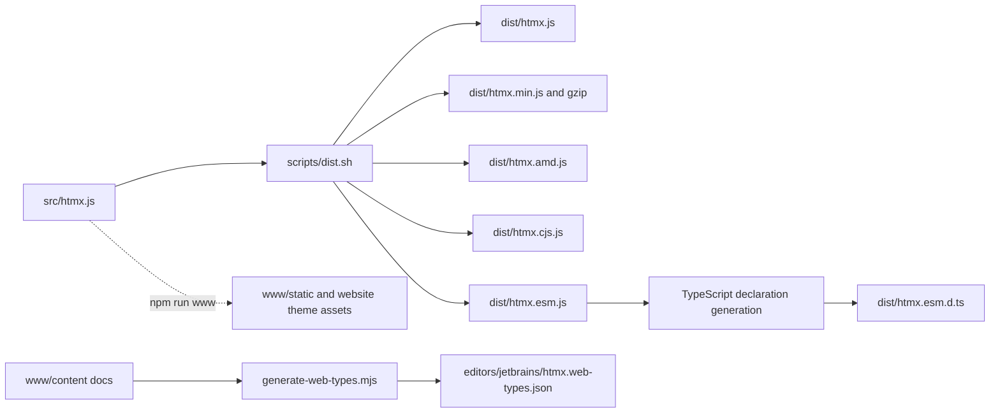

The core code is intentionally kept in one source file. The website is a separate Zola static site; tests exercise the runtime in real browser engines.

[↑ Back to Table of Contents](#table-of-contents)

## 3. High-Level System Context

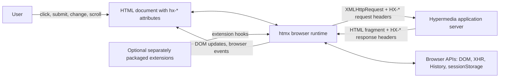

| Boundary | Contract |
|---|---|
| Page → htmx | `hx-*` / `data-hx-*` attributes, `<meta name="htmx-config">`, public `htmx.*` API |
| htmx → server | XHR; request metadata such as `HX-Request`, `HX-Trigger`, `HX-Target`, `HX-Current-URL`, and `HX-Boosted` |
| Server → htmx | HTML response body, status code, and optional `HX-*` response headers |
| Extensions ↔ htmx | `htmx.defineExtension()` with lifecycle, encoding, response-transform, and swap hooks |

[↑ Back to Table of Contents](#table-of-contents)

## 4. Core Module Decomposition

Though implemented in one closure, `src/htmx.js` is sectioned into logical subsystems:

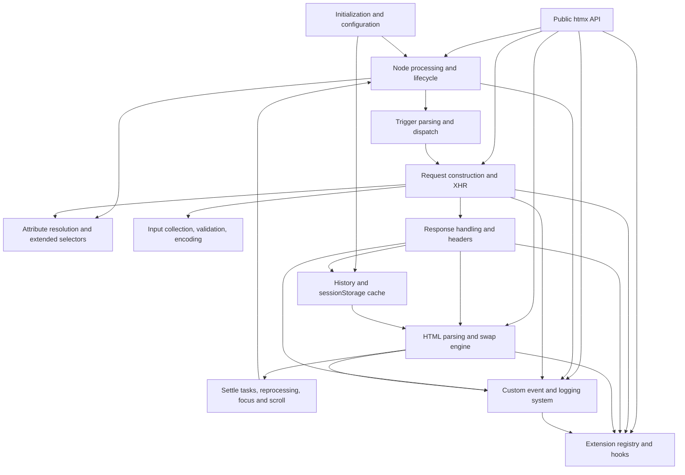

A key feedback loop is **swap → settle → processNode**: newly inserted fragments are processed just like initial markup, enabling declarative behaviour to compose across server responses.

[↑ Back to Table of Contents](#table-of-contents)

## 5. Public API & Internal API

The public `htmx` object exposes event, request, DOM, swap, extension, debugging, configuration, and utility APIs. Functions are assigned to the object after declaration. Extensions receive a narrower `internalAPI` object through their `init` hook.

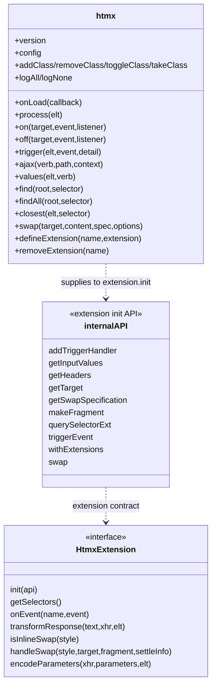

[↑ Back to Table of Contents](#table-of-contents)

## 6. Configuration Model

Runtime defaults are defined in `htmx.config`. During initialization, `mergeMetaConfig()` merges JSON from `<meta name="htmx-config" content="...">` over defaults. Applications may also modify `htmx.config` at runtime.

Important defaults include:

| Area | Defaults |
|---|---|
| History | enabled; cache size 10; cache miss fetches server unless configured to refresh |
| Swap | `innerHTML`; 0 ms swap delay; 20 ms settle delay |
| Request methods | `get` and `delete` parameters go in URL by default |
| Response status | 204: no swap; 2xx/3xx: swap; 4xx/5xx: no swap and error |
| Security | same-origin requests only; `allowEval` and `allowScriptTags` enabled by default |
| UI classes | `htmx-request`, `htmx-indicator`, `htmx-added`, `htmx-swapping`, `htmx-settling` |
| Transitions | global View Transitions disabled by default |
| Credentials | `withCredentials` false; timeout 0 |

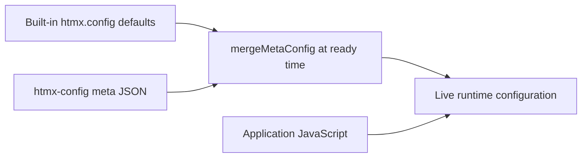

[↑ Back to Table of Contents](#table-of-contents)

## 7. Bootstrap & Initialization Workflow

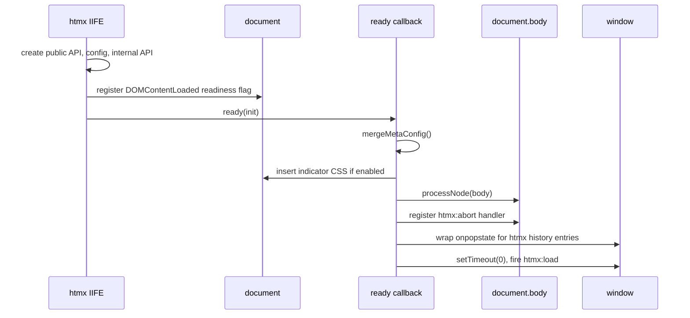

`ready()` accounts for both normal page loading and scripts inserted after the document is already loaded. The initial `processNode(body)` scans the document and installs behaviour.

[↑ Back to Table of Contents](#table-of-contents)

## 8. Node Processing Pipeline

`processNode(elt)` resolves an element or selector, rejects disabled subtrees, scans for actionable elements, detects changed attributes, installs `hx-on` handlers, and initializes nodes.

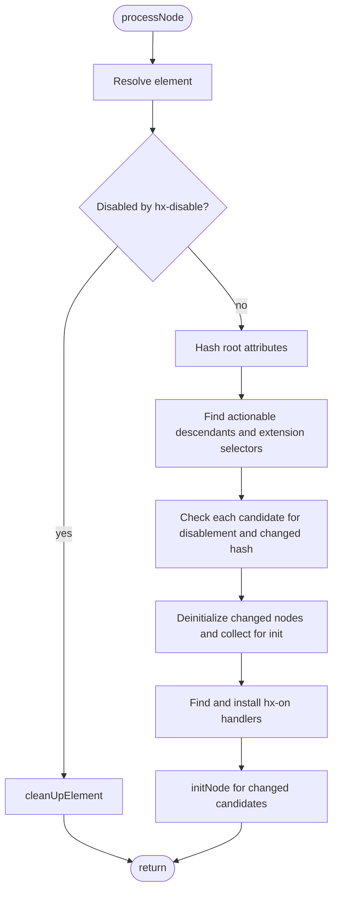

`attributeHash()` provides idempotency: unchanged elements are not rebound on repeated processing. If attributes change, `deInitNode()` removes old listeners/timers before reinitialization. `initNode()` chooses explicit HTTP verbs, boosted links/forms, trigger-only behaviour, and submit-button tracking.

[↑ Back to Table of Contents](#table-of-contents)

## 9. Trigger System

`hx-trigger` is parsed by a tokenizer and parser into `HtmxTriggerSpecification` objects. Supported behaviour includes event filters, `once`, `changed`, `consume`, delay/throttle, `from`, `target`, queue policy, polling (`every`), `revealed`, and `intersect`.

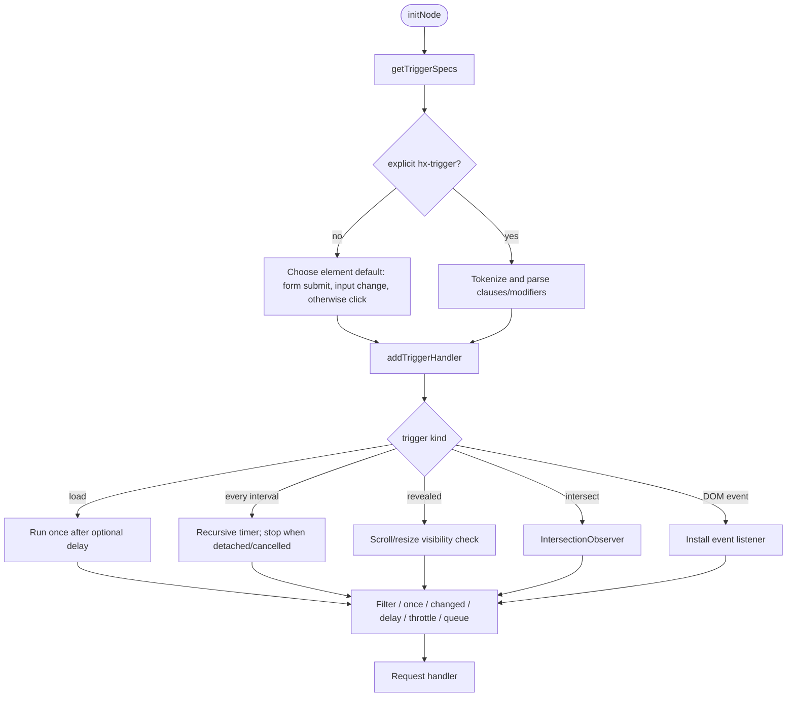

| Element kind | Default trigger |
|---|---|
| `<form>` | `submit` |
| Submit/button inputs | `click` |
| `input`, `textarea`, `select` | `change` |
| Other elements | `click` |

[↑ Back to Table of Contents](#table-of-contents)

## 10. Attribute Inheritance & Extended Selectors

Most `hx-*` values are resolved from the triggering element up its ancestor chain. `hx-inherit`, `hx-disinherit`, and `config.disableInheritance` control inheritance. The traversal supports shadow-root parent relationships.

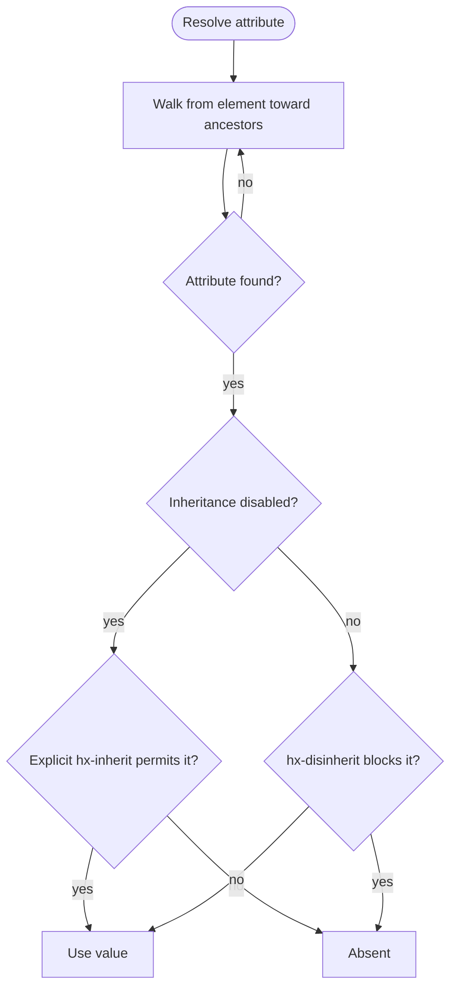

The extended selector engine supports standard CSS plus relative forms such as `this`, `closest`, `find`, `next`, `previous`, `document`, `window`, `body`, `root`, `host`, and `global`. It is used by target, include, indicator, event-source, and other selector-valued attributes.

[↑ Back to Table of Contents](#table-of-contents)

## 11. Request Lifecycle

`issueAjaxRequest()` is the central request coordinator. It validates the trigger/target, applies submitter overrides, supports confirmation and prompts, enforces synchronization, gathers input, emits mutable/cancellable events, verifies the URL, configures XHR, sends the request, and dispatches response/error events.

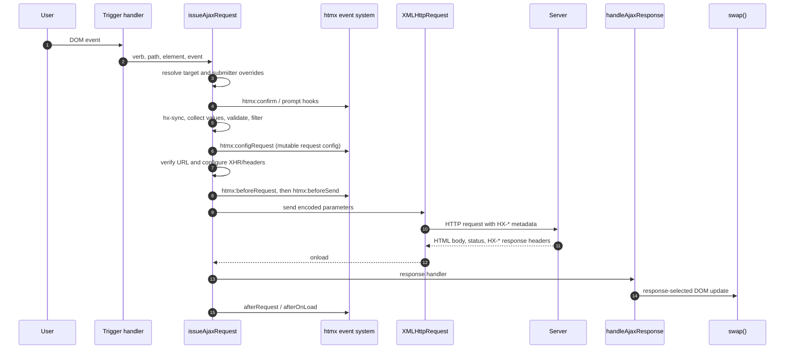

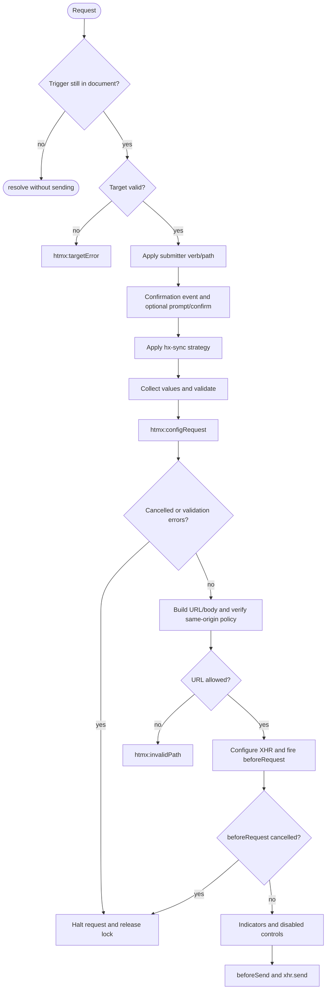

[↑ Back to Table of Contents](#table-of-contents)

## 12. Request Synchronization

Per-element internal state tracks `xhr`, whether it is abortable, and queued callbacks. `hx-sync` coordinates requests against a selected element.

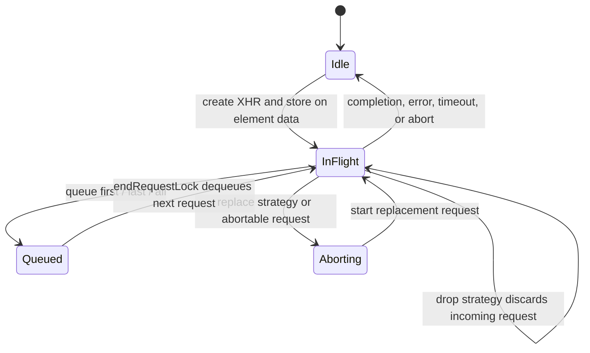

| Strategy | Effect while request is active |
|---|---|
| `drop` | Discard the new request (default) |
| `abort` | Abortable state governs whether current work can be replaced; otherwise drop |
| `replace` | Trigger `htmx:abort`, then continue with the new request |
| `queue first` | Retain the first pending request |
| `queue last` | Keep only the most recent pending request |
| `queue all` | Retain all pending requests |

[↑ Back to Table of Contents](#table-of-contents)

## 13. Input Collection & Parameter Encoding

`getInputValues()` returns validation errors, a native `FormData`, and a proxy view used for compatibility. Non-GET requests include the related form; `hx-include`, submitter values, `hx-vals`, `hx-vars`, and `hx-params` modify the effective parameter set.

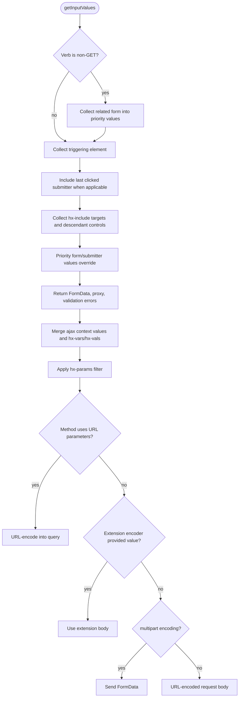

Native browser validation is performed when applicable. Validation events are emitted, and errors halt transmission with `htmx:validation:halted`.

[↑ Back to Table of Contents](#table-of-contents)

## 14. Response Handling

`handleAjaxResponse()` first gives listeners a chance to cancel `htmx:beforeOnLoad`, dispatches server-triggered events, handles redirect/refresh headers, determines history changes, resolves status-code behaviour, applies retarget/reswap/reselect directives, and then optionally swaps.

```mermaid
flowchart TD
  A([XHR response]) --> B[htmx:beforeOnLoad]
  B --> C[Dispatch HX-Trigger]
  C --> D{HX-Location?}
  D -- yes --> D1[Issue htmx GET navigation]
  D -- no --> E{HX-Redirect or HX-Refresh?}
  E -- yes --> E1[Browser navigation/reload]
  E -- no --> F[Resolve history update]
  F --> G[Resolve responseHandling by HTTP status]
  G --> H[Apply HX-Retarget, HX-Reswap, HX-Reselect]
  H --> I[htmx:beforeSwap; listeners may mutate details]
  I --> J{shouldSwap?}
  J -- no --> K[Emit response error if configured]
  J -- yes --> L[Extension transformResponse]
  L --> M[Save current history if needed]
  M --> N[swap(target, response, specification)]
  N --> O[After-swap and after-settle trigger headers]
```

Response status handling is configurable with regular-expression-like status match strings. Response headers provide server-side controls such as `HX-Trigger`, `HX-Location`, `HX-Redirect`, `HX-Refresh`, `HX-Retarget`, `HX-Reswap`, `HX-Reselect`, `HX-Push-Url`, and `HX-Replace-Url`.

[↑ Back to Table of Contents](#table-of-contents)

## 15. Swap Engine

`swap()` parses HTML into a detached fragment, optionally runs a View Transition, performs OOB and partial swaps before the main swap, applies the selected swap style, restores focus/selection, updates the title, and settles new nodes.

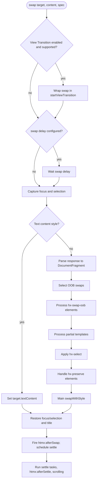

Built-in styles include `innerHTML`, `outerHTML`, `beforebegin`, `afterbegin`, `beforeend`, `afterend`, `delete`, and `none`. `textContent` is handled directly by `swap()`. Extensions may implement custom swap styles through `handleSwap()`.

[↑ Back to Table of Contents](#table-of-contents)

## 16. Out-of-Band, Partial & Preserved Swaps

```mermaid
flowchart TD
  RESP[Parsed response fragment] --> SELECTOOB[hx-select-oob selection]
  SELECTOOB --> OOB[Find hx-swap-oob elements]
  OOB --> PARTIAL[Find template[hx] partials]
  PARTIAL --> SELECT[hx-select main-fragment selection]
  SELECT --> PRESERVE[Match hx-preserve elements by id]
  PRESERVE --> MAIN[Perform main target swap]
  MAIN --> RESTORE[Restore preserved nodes]
```

- **Out-of-band swap:** `hx-swap-oob` directs a response node to update a different target, normally selected by its id; missing targets emit an error event.
- **Partial templates:** `<hx-…>` response tags are rewritten to `<template hx type="…">` before parsing. `type="partial"` templates can target a node using `hx-target` or their id and trigger partial lifecycle events. Other types emit `htmx:processTemplate` for integrations.
- **Preserved elements:** `hx-preserve` nodes with matching ids are moved through the swap rather than recreated. Where supported, `moveBefore` is used to preserve browser-managed state; otherwise the existing node replaces the incoming placeholder.

The processing order is OOB selection/swaps, partials, main-fragment selection, preservation, and the main swap.

[↑ Back to Table of Contents](#table-of-contents)

## 17. Settle Phase & Element Lifecycle

The settle phase delays final attribute application to support CSS transitions, processes inserted nodes, restores focus, and emits lifecycle events.

```mermaid
sequenceDiagram
  participant Swap as swap()
  participant DOM
  participant Settle as settle tasks
  participant Process as processNode
  Swap->>DOM: Insert fragment nodes and add htmx-added
  Swap->>DOM: Temporarily retain matching id attributes for transition
  Swap->>Settle: Queue attribute restoration and load tasks
  Note over Swap,Settle: default settle delay is 20 ms
  Settle->>DOM: Apply final attributes; remove htmx-settling
  Settle->>Process: Process inserted element subtree
  Process-->>DOM: Install htmx behaviours on new content
  Settle->>DOM: Focus autofocus element; emit htmx:load/afterSettle
  Settle->>DOM: Apply scroll/show options
```

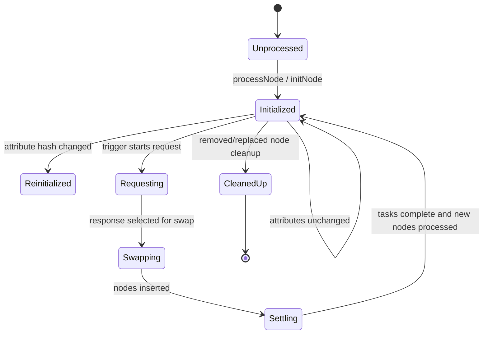

[↑ Back to Table of Contents](#table-of-contents)

## 18. Event System

`triggerEvent()` creates bubbling, cancellable, composed `CustomEvent`s. The return value reflects cancellation and extension vetoes. Most events also dispatch a kebab-case alias. Events provide application hooks, cancellation points, extension integration, and error reporting.

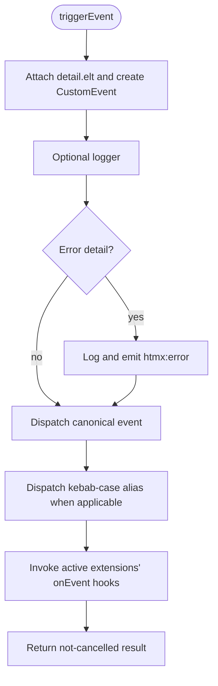

Major event groups include node processing (`beforeProcessNode`, `afterProcessNode`, `load`), request (`trigger`, `confirm`, `configRequest`, `beforeRequest`, `beforeSend`, `afterRequest`), response/swap (`beforeOnLoad`, `beforeSwap`, `afterSwap`, `afterSettle`), validation, errors, history, and OOB/partial swaps. `hx-on:*` and `hx-on-*` attributes attach inline handlers, subject to `allowEval`.

[↑ Back to Table of Contents](#table-of-contents)

## 19. History Subsystem

History uses the browser History API plus a bounded `sessionStorage` cache. The saved item contains normalized URL, selected HTML content, title, and scroll position. `hx-history-elt` selects the snapshot region; absent that attribute, the body is used. `hx-history="false"` opts out of snapshotting the page content.

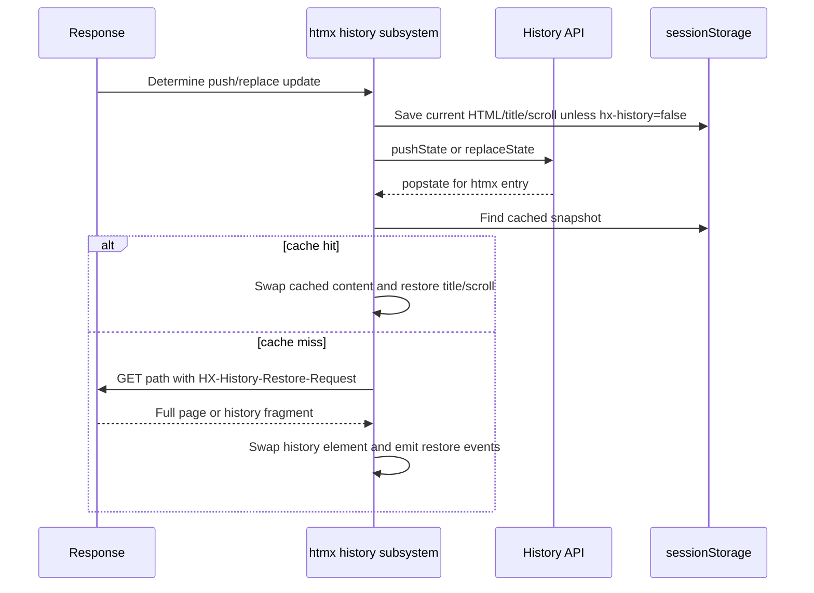

If storage is unavailable or quota is exceeded, history gracefully falls back; on quota errors the cache is reduced and retried. A configured cache miss may trigger a full reload instead of an XHR restore.

[↑ Back to Table of Contents](#table-of-contents)

## 20. Extension Architecture

Extensions are registered in a runtime map with `defineExtension(name, implementation)`. The implementation is merged with defaults. `hx-ext` activates extensions on an element and inherited ancestors; `ignore:name` excludes one. Extensions live in separate packages; `dist/ext/` contains legacy htmx 1.x files retained to preserve older URLs and is not actively maintained for v2.

```mermaid
classDiagram
  class ExtensionRegistry {
    -extensions: Map
    +defineExtension(name, partial)
    +removeExtension(name)
    +getExtensions(element)
    +withExtensions(element, callback)
  }
  class HtmxExtension {
    <<interface>>
    init(api)
    getSelectors()
    onEvent(name,event)
    transformResponse(text,xhr,elt)
    isInlineSwap(style)
    handleSwap(style,target,fragment,settleInfo)
    encodeParameters(xhr,parameters,elt)
  }
  ExtensionRegistry --> HtmxExtension
```

```mermaid
flowchart LR
  SCAN[Node scan] -->|getSelectors| EXT[Extension]
  EVENT[Custom event] -->|onEvent| EXT
  PARAMS[Request body] -->|encodeParameters| EXT
  RESPONSE[Response text] -->|transformResponse| EXT
  SWAP[Custom swap style] -->|handleSwap / isInlineSwap| EXT
  TEMPLATE[Unknown template type] -->|htmx:processTemplate| EXT
```

[↑ Back to Table of Contents](#table-of-contents)

## 21. Internal Data Model

Per-element state is stored on the element under `htmx-internal-data`. Request and swap flow objects are plain objects described with JSDoc typedefs in the source.

```mermaid
classDiagram
  class HtmxNodeInternalData {
    initHash
    boosted
    listenerInfos
    timeout
    triggeredOnce
    delayed
    throttle
    lastValue
    loaded
    path
    verb
    polling
    lastButtonClicked
    requestCount
    xhr
    queuedRequests
    abortable
    firstInitCompleted
  }
  class HtmxRequestConfig {
    boosted
    useUrlParams
    formData
    parameters
    headers
    elt
    target
    verb
    errors
    withCredentials
    timeout
    path
    triggeringEvent
  }
  class HtmxResponseInfo {
    xhr
    target
    requestConfig
    pathInfo
    successful
    failed
    keepIndicators
  }
  class HtmxSwapSpecification {
    swapStyle
    swapDelay
    settleDelay
    transition
    ignoreTitle
    scroll
    show
    focusScroll
  }
  class HtmxSettleInfo {
    tasks
    elts
    title
  }
  HtmxResponseInfo --> HtmxRequestConfig
  HtmxResponseInfo --> HtmxSwapSpecification
```

[↑ Back to Table of Contents](#table-of-contents)

## 22. Security Controls

```mermaid
flowchart TD
  EVAL[Expression evaluation: filters, hx-vars, hx-on] --> ALLOW{config.allowEval?}
  ALLOW -- no --> ERR[htmx:evalDisallowedError; use fallback]
  ALLOW -- yes --> RUN[Evaluate configured expression]
  SCRIPT[Scripts in response fragment] --> SCRIPTS{config.allowScriptTags?}
  SCRIPTS -- no --> STRIP[Remove script tags]
  SCRIPTS -- yes --> NORMALIZE[Normalize executable scripts; optionally apply nonce]
  URL[Final request URL] --> ORIGIN{selfRequestsOnly and same origin?}
  ORIGIN -- no --> BLOCK[htmx:invalidPath]
  ORIGIN -- yes --> VALIDATE[htmx:validateUrl event]
  HISTORY[Page snapshot] --> PRIVATE{hx-history=false present?}
  PRIVATE -- yes --> SKIP[Do not cache snapshot]
  PRIVATE -- no --> CACHE[Cache in sessionStorage]
```

Other relevant protections include a same-origin request default, configurable script/style CSP nonces, selector escaping for generated id selectors, and the history-cache opt-out for sensitive pages. Since `allowEval` and script interpretation are enabled by default in this version, applications with strict CSP requirements should configure them appropriately and review server-returned HTML policy.

[↑ Back to Table of Contents](#table-of-contents)

## 23. Build & Distribution

`npm run dist` invokes the shell distribution builder, generates declarations with TypeScript, and generates JetBrains web-types from website documentation.

```mermaid
flowchart TD
  RUN[npm run dist] --> SH[scripts/dist.sh]
  SH --> COPY[Copy src/htmx.js to dist/htmx.js]
  COPY --> MIN[Uglify minification and gzip]
  MIN --> AMD[AMD wrapper]
  AMD --> CJS[CommonJS wrapper]
  CJS --> ESM[ES module wrapper]
  RUN --> TYPES[tsc declaration generation]
  ESM --> TYPES
  TYPES --> DT[dist/htmx.esm.d.ts]
  RUN --> WT[generate-web-types.mjs]
  DOC[www/content attribute/reference/event docs] --> WT
  WT --> IDE[editors/jetbrains/htmx.web-types.json]
```

| Package field | Target |
|---|---|
| `main` | `dist/htmx.esm.js` |
| `types` | `dist/htmx.esm.d.ts` |
| `jsdelivr`, `unpkg` | `dist/htmx.min.js` |
| `web-types` | `editors/jetbrains/htmx.web-types.json` |
| License | 0BSD |

The source is also copied into website static assets by `npm run www`; the website itself is served locally with Zola as documented in `www/README.md`.

[↑ Back to Table of Contents](#table-of-contents)

## 24. Testing Architecture

The repository has both a manual Mocha browser page and automated browser tests. `web-test-runner.config.mjs` loads the runtime and test helpers into a browser page, runs attribute/core tests with Playwright, and enables coverage for `src/htmx.js`.

```mermaid
flowchart LR
  MANUAL[test/index.html: Mocha BDD browser suite] --> HARNESS[Test harness]
  AUTO[Web Test Runner + Playwright] --> HARNESS
  HARNESS --> CHAI[Chai / chai-dom]
  HARNESS --> SINON[Sinon XHR mocking]
  HARNESS --> SOCKET[mock-socket]
  HARNESS --> UTIL[test/util/util.js]
  HARNESS --> CORE[test/core/**/*.js]
  HARNESS --> ATTR[test/attributes/**/*.js]
  AUTO --> COV[Coverage: src/htmx.js]
  TYPE[TypeScript checkJs and declaration generation] --> CI[Validation]
```

The manual test page also links manual and scratch scenarios. Automated suites cover core behaviour and individual attributes; browser-specific scripts support Chromium, Firefox, and WebKit.

[↑ Back to Table of Contents](#table-of-contents)

## 25. CI/CD Workflow

`.github/workflows/ci.yml` defines a Node CI job on Ubuntu 22.04, using Node 20, `npm ci`, and `npm test` for configured push and pull-request branches. `npm test` runs lint, type checking, and the Chromium browser suite. The package also provides all-browser test commands.

```mermaid
flowchart LR
  EVENT[Push or pull request on configured branch] --> CHECKOUT[actions/checkout]
  CHECKOUT --> NODE[Set up Node.js 20]
  NODE --> INSTALL[npm ci]
  INSTALL --> TEST[npm test]
  TEST --> LINT[ESLint]
  LINT --> TYPES[TypeScript checkJs]
  TYPES --> BROWSER[Playwright Chromium tests]
```

The workflow's branch filters are `master`, `dev`, `htmx-2.0`, and `v2.0v2.0`; `uat` is not listed as a push target in the workflow configuration.

[↑ Back to Table of Contents](#table-of-contents)

## 26. Consumer Integration

```mermaid
flowchart TB
  subgraph Distribution
    CDN[CDN script: dist/htmx.min.js]
    NPM[npm package: ESM / CJS / AMD]
  end
  subgraph BrowserPage[Application page]
    CONFIG[Optional htmx-config meta]
    MARKUP[HTML annotated with hx-*]
    RUNTIME[htmx runtime]
  end
  subgraph Server[Application server]
    ROUTE[Route/action]
    HTML[HTML fragment response]
    HEADERS[HX-* response directives]
  end
  CDN --> RUNTIME
  NPM --> RUNTIME
  CONFIG --> RUNTIME
  MARKUP --> RUNTIME
  RUNTIME -->|XHR + HX request metadata| ROUTE
  ROUTE --> HTML
  ROUTE --> HEADERS
  HTML --> RUNTIME
  HEADERS --> RUNTIME
  RUNTIME --> MARKUP
```

The backend is intentionally unconstrained: it may be implemented in any language/framework, provided it handles the HTTP request and returns appropriate HTML. It can use `HX-Request` to distinguish htmx requests and respond with a fragment where appropriate.

[↑ Back to Table of Contents](#table-of-contents)

## 27. Design Decisions & Trade-offs

| Decision | Benefit | Trade-off |
|---|---|---|
| Single IIFE source file | Small, dependency-free, broadly embeddable distribution | Logical modules are not enforced by file boundaries |
| Declarative attributes | Behaviour is visible in HTML and integrates with server-rendered views | Attribute inheritance and selector resolution add complexity |
| Custom events as hooks | One mechanism supports app callbacks, cancellation, extensions, and observability | Large event surface; event ordering is part of compatibility |
| XMLHttpRequest transport | Upload/download progress, abort, familiar browser support | No native fetch streaming pipeline |
| Swap plus settle phases | Supports progressive CSS transitions and post-insertion processing | Requires temporary classes and deferred tasks |
| sessionStorage history snapshots | Fast back/forward restoration without a server round trip on cache hit | Storage quota and sensitive-content concerns; opt-out exists |
| FormData-backed parameter proxy | Supports multiple values and files with compatibility object semantics | Proxy behaviour is more complex than a plain object |
| Externalized extensions | Keeps core small and lets integrations evolve independently | Extension availability/versioning is managed separately |

[↑ Back to Table of Contents](#table-of-contents)

## 28. Glossary

| Term | Meaning |
|---|---|
| **Boost** | Progressive enhancement of eligible links/forms into AJAX navigation via `hx-boost`. |
| **OOB** | Out-of-band response fragment swap targeting a different DOM node via `hx-swap-oob`. |
| **Partial** | Response template of type `partial`, independently targeting a node. |
| **Settle** | Post-insertion phase for attribute reconciliation, node processing, focus, and lifecycle events. |
| **Trigger specification** | Parsed event/polling rule built from one `hx-trigger` clause. |
| **Internal data** | Per-element runtime state stored under `htmx-internal-data`. |
| **Extended selector** | htmx selector dialect layered over CSS selectors. |
| **286 response** | A status recognized by htmx to cancel polling for the triggering element. |
| **DUMMY_ELT** | Sentinel target used to surface a target resolution error rather than accidentally swapping into the body. |

[↑ Back to Table of Contents](#table-of-contents)
